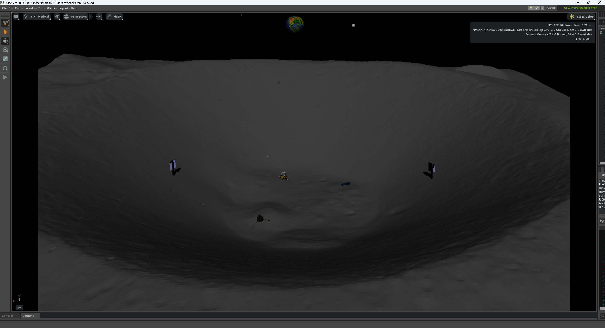
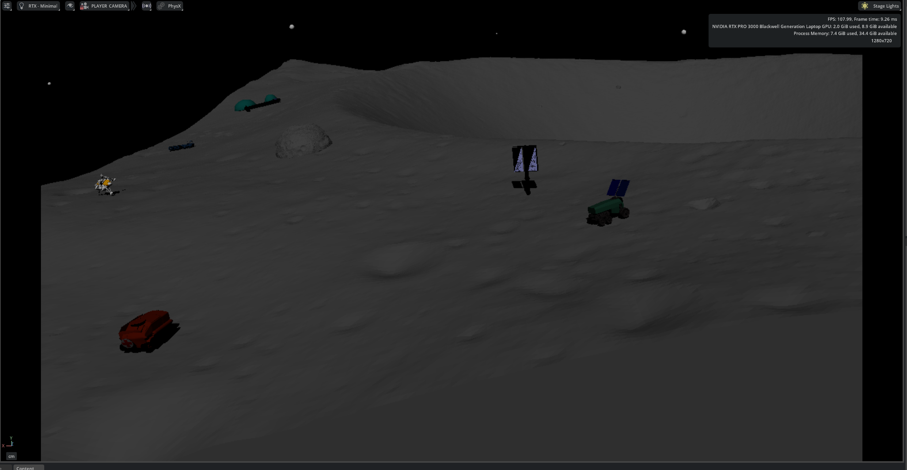
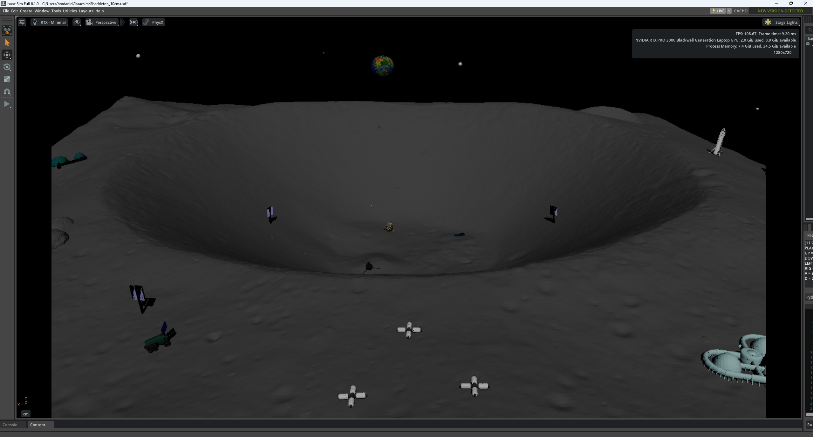
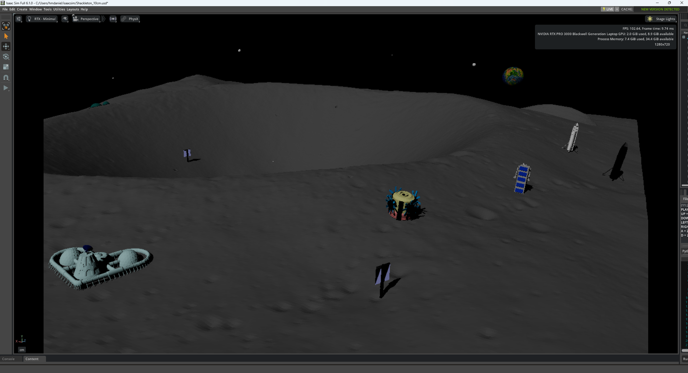

# 🌙 Lunar Shackleton Crater Digital Twin Simulation

An interactive Digital Twin simulation of Shackleton Crater developed during a NASA OSTEM Internship using NVIDIA Omniverse Isaac Sim.

## 🚀 Controls

### Use the Arrow Keys on Your Keyboard to Move the Simulation

⬆️ Move Forward

⬇️ Move Backward

⬅️ Turn Left

➡️ Turn Right

## Features

- Interactive lunar exploration
- Realistic Shackleton Crater environment
- Digital Twin simulation
- Lunar infrastructure and assets
- Python-based movement controls

## Built With

- NVIDIA Omniverse Isaac Sim
- Python
- Autodesk Maya
- USD

## Screenshots

### Interior View

### Left Side View

### Center View

### Right Side View

## Author

Daniel Hilena

NASA OSTEM Intern
